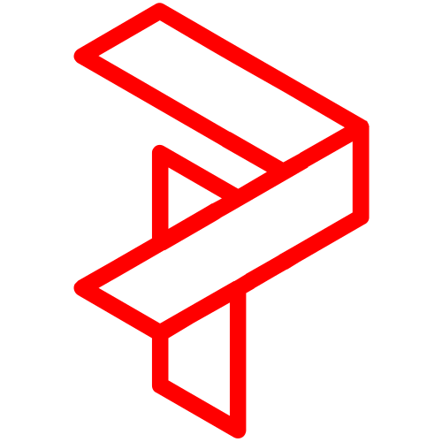
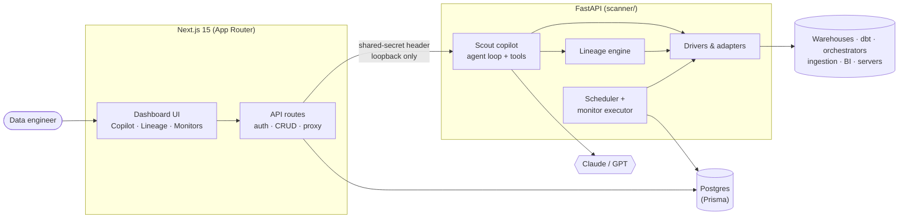

<div align="center">



# Pallisade Co-Pilot

**An AI copilot and reliability layer for data pipelines.**
Ask questions of your warehouse, trace lineage across the whole stack, and catch broken data before your dashboards do.


</div>

---

Data teams lose hours stitching together context from the warehouse, dbt, the orchestrator and the BI tool every time a number looks wrong. Pallisade connects to all of them, builds one lineage graph across the stack, and puts **Scout**, an LLM agent with live, read-only access to that graph and your warehouses, in front of it. Scout answers questions with real queries instead of guesses, walks upstream to find root causes, and sets up the monitors that would have caught the problem.

## What it does

**Scout copilot.** A tool-calling agent (Claude or GPT) with modes for asking, debugging, planning, explaining, suggesting and fixing. It pre-fetches the warehouse schema every turn, so it writes SQL against columns that actually exist. It streams responses over SSE and pauses for approval before anything with side effects, such as opening a GitHub PR.

**Cross-stack lineage.** An extraction engine with live adapters for warehouses, dbt, Airflow, Dagster, Prefect, Fivetran, Airbyte and the major BI tools merges everything into one graph. Every edge carries a confidence score and the evidence behind it: the exact SQL statement or manifest entry. Nodes are deduplicated across sources, so the same table seen by dbt and the warehouse resolves to one node.

**Monitors and SLA discovery.** Freshness, volume, schema drift, null rate, uniqueness, distribution, referential integrity and custom-SQL checks, plus TLS, server-health and log monitors over SSH. Pallisade profiles a table to propose thresholds, runs checks on a schedule, and routes alerts to Slack, Teams, PagerDuty or OpsGenie.

**Change plans.** Scout traces the downstream impact of a schema or model change, generates the patches, validates them, and opens a GitHub PR with rollback steps included.

**About 40 integrations.** BigQuery, Snowflake, Postgres, Redshift, Databricks, SQL Server, Azure SQL and Synapse, MySQL, dbt Cloud and Core, Airflow, Dagster, Prefect, Fivetran, Airbyte, Stitch, Looker, Tableau, Power BI, Metabase, S3, GCS, ADLS, GitHub, GitLab, Bitbucket, Jira, Linear and Asana.

The full feature tour is in [`docs/product-overview.md`](docs/product-overview.md).

## Architecture



The Next.js app owns users, orgs, pipelines and encrypted credentials. The Python service does everything that touches customer infrastructure. Pallisade is **monitor-only**: it reads metadata and runs checks, but never moves or stores customer data beyond derived metrics.

### Engineering notes

- **Grounded SQL generation.** The warehouse schema is fetched before the system prompt is built, and every generated query has its columns validated against it before it runs. Schemas from multiple warehouses are keyed as `WAREHOUSE:dataset`, so a pipeline with BigQuery and Snowflake never mixes them up.
- **Dialect-agnostic monitors.** Monitor SQL is built once and transpiled to the target dialect with `sqlglot`. Identifiers and literals go through a dedicated escaping layer, because table and column names are user-controlled input.
- **Stable lineage IDs.** Node IDs come from `(domain, namespace, container, name)` and exclude the platform. That lets edges found by different adapters line up on the same node.
- **Noise control.** Volume and null-rate baselines use Z-scores with day-of-week seasonality and adaptive lookback windows. A second LLM pass reviews FAIL and WARN results and can downgrade false positives, but it never sees passing checks, so it can't create alerts.
- **Multi-agent mode (optional).** Narrow tasks such as SQL generation and log triage can go to smaller specialist models. Their JSON output is verified deterministically before the main model narrates the answer (see [`scanner/copilot/maas`](scanner/copilot/maas)).
- **MCP bridge.** The lineage engine and Airflow are also exposed as Model Context Protocol servers.

### Security model

- FastAPI accepts requests only from the Next.js server, authenticated with an `X-Internal-Auth` shared secret. In production it refuses to start on a non-loopback interface or with a wildcard CORS origin.
- Integration credentials are encrypted at rest with AES-256-GCM.
- Copilot warehouse access is limited to `SELECT` and `WITH … SELECT`.
- Pipeline profiles are isolated workspaces: integrations, lineage and caches are scoped per pipeline and per org.

## Getting started

**Prerequisites:** Node 22+, Python 3.14, PostgreSQL, and an Anthropic or OpenAI API key.

```bash
git clone https://github.com/EmilFabel04/pallisade-copilot.git
cd pallisade-copilot
cp .env.example .env        # set DATABASE_URL, AUTH_SECRET and an LLM key

# Web app
npm install                 # also generates the Prisma client
npm run db:push             # create the schema
npm run dev                 # http://localhost:3000

# Backend, in a second terminal
cd scanner
python -m venv venv && source venv/bin/activate
pip install -r requirements.txt
uvicorn api.app:app --reload --port 8000
```

Sign up, create a pipeline, connect a warehouse, then open **Assistant** to talk to Scout. Every environment variable is documented in [`.env.example`](.env.example).

To call the backend directly during development:

```bash
curl -H "X-Internal-Auth: $SCANNER_SHARED_SECRET" \
     -H "X-Acting-User: $USER_ID" -H "X-Acting-Org: $ORG_ID" \
     http://127.0.0.1:8000/api/v1/drivers
```

## Tests

```bash
cd scanner && pytest        # backend: 3,000+ tests
npx jest                    # frontend unit tests
```

CI ([`.github/workflows/ci.yml`](.github/workflows/ci.yml)) runs lint, type-check and the Next.js build, plus the Python tests.

## Repository layout

```
app/            Next.js routes: dashboard pages and API routes (the BFF)
components/     React components: copilot chat, lineage graph, monitors, pipeline builder
contexts/       React providers (active pipeline, sidebar, theme)
hooks/          Shared hooks, including streaming chat
lib/            Auth, crypto, scanner client, domain utilities
types/          Shared TypeScript types
content/docs/   In-app product docs (MDX)
prisma/         Database schema
scanner/        FastAPI backend
  api/            routers, auth, startup checks
  copilot/        Scout: agent loop, tools, modes, multi-agent mode
  lineage/        lineage engine and SLA discovery
  monitors/       monitor implementations and baselines
  scheduler/      scheduled execution and alert routing
  drivers/        integration drivers, grouped by category
  adapters/       warehouse adapters and SQL safety
  mcp_bridge/     MCP servers and client
scripts/        One-off maintenance and migration scripts
docs/           Architecture notes, design specs, runbooks
```

## Documentation

| Doc | Covers |
|---|---|
| [Product overview](docs/product-overview.md) | Full feature tour and integration matrix |
| [Copilot architecture](docs/copilot-architecture.md) | Request flow, prompt construction, tool execution |
| [Lineage system](docs/lineage-system.md) | Extraction engine, adapters, graph model |
| [Monitors](docs/monitors.md) · [Structured monitors](docs/structured-monitors.md) | Monitor types, baselines, scheduling |
| [Pipeline overview](docs/pipeline-overview-system.md) | Pipeline profiles and the overview canvas |
| [Driver contract](docs/tool_wiring.md) | How to add an integration |
| [Design specs](docs/superpowers/specs) | Design documents for major features |
